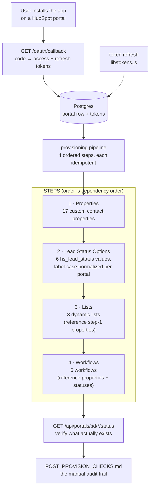

# HubSpot Provisioner

A HubSpot Public App that provisions a GTM-ready CRM in one install: 17 contact properties, 6 lead-status options, 3 dynamic lists, and 6 workflows land on the target portal in about 30 seconds. The problem it kills: standing up the same CRM skeleton by hand, portal after portal, and getting it subtly different every time.

This repo is the clean template. It holds no deployment-specific state (no URLs, no client IDs, no secrets); each deployment is a fork with its own env. Fixes land here first and get cherry-picked outward.

## The DAG



Each step receives the shared context and may extend it for later steps, which is how lists and workflows resolve the property IDs that step 1 created. Steps handle 409s, so re-running provisioning against a half-configured portal converges instead of erroring.

## What's in the box

```
hubspot-app/     Public App definition + embedded React settings page
                 (OAuth scopes, redirect URL, hsproject.json)
server/          Express host: OAuth callback, token storage (Postgres),
                 provisioning pipeline, per-portal status routes
```

| Piece | File |
|---|---|
| Pipeline orchestrator (the STEPS array) | `server/src/provisioning/index.js` |
| 17 contact properties | `server/src/provisioning/properties.js` |
| 6 lead-status options + portal-value translation | `server/src/provisioning/lead-status-options.js` |
| 3 dynamic lists | `server/src/provisioning/lists.js` |
| 6 workflows (1 disabled by design) | `server/src/provisioning/workflows.js` |
| OAuth callback + token refresh | `server/src/oauth.js`, `server/src/lib/tokens.js` |
| Post-provision verification checklist | `server/POST_PROVISION_CHECKS.md` |

## Honesty notes

- There used to be a 5th step, `Dashboards`. It was an empty stub that reported a false-positive checkmark, and it was deleted during the 2026-05-24 audit rather than kept for the demo. The audit reports live in `docs/audits/`.
- One of the 6 workflows ships disabled by design; enabling it is a per-deployment decision.
- Provisioning results are verified by reading the portal back (`/api/portals/:id/*/status`), not by trusting the create calls.

## Run it

```bash
cd server
cp .env.example .env     # HubSpot app credentials + DATABASE_URL
npm install
node src/migrate.js      # Postgres schema
node src/index.js        # Express on PORT, /health to confirm
```

Deploys on Railway via `railway.toml` (NIXPACKS, runs migrate then the server). Create the Public App from `hubspot-app/` with the HubSpot CLI, point its redirect URL at `/oauth/callback`, and install it on a test portal.
